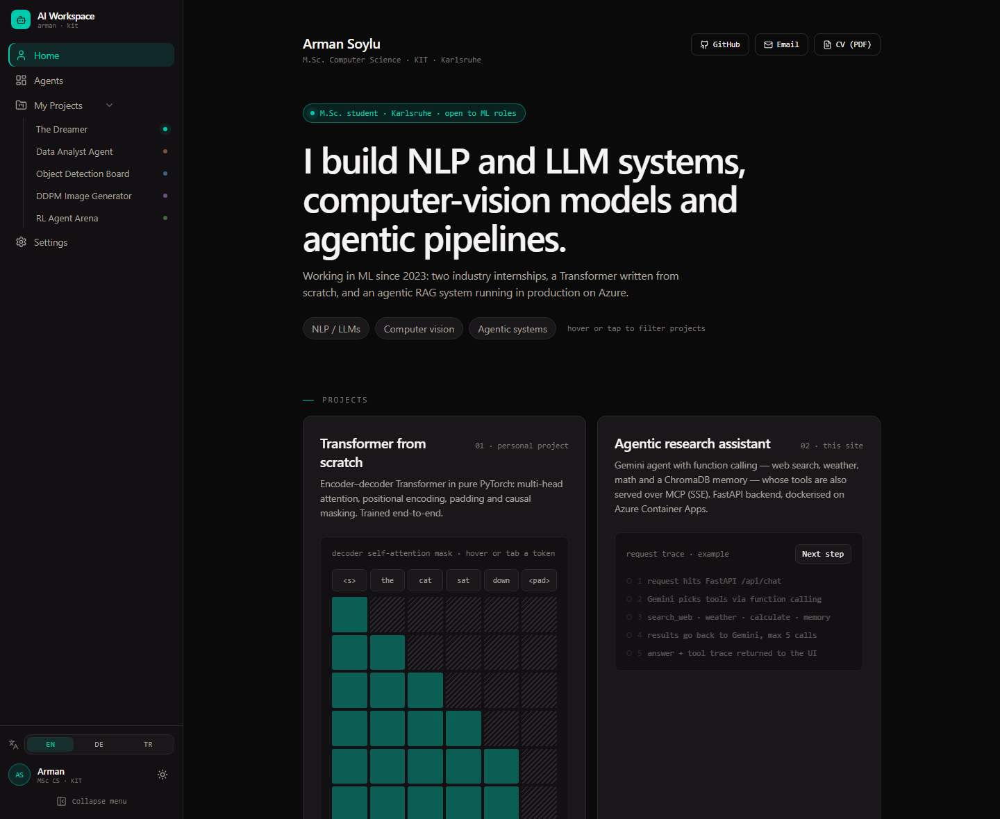
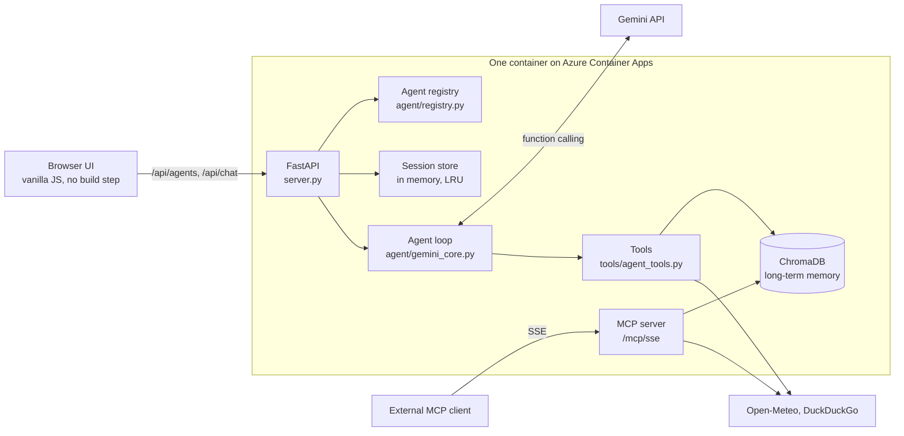
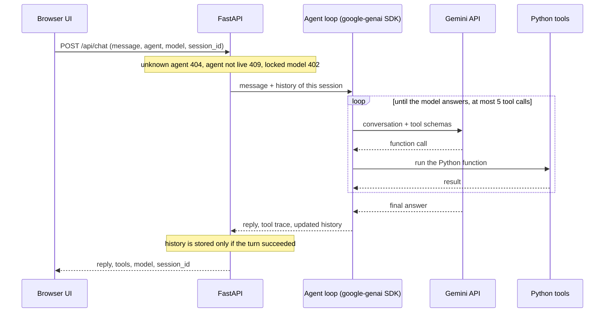
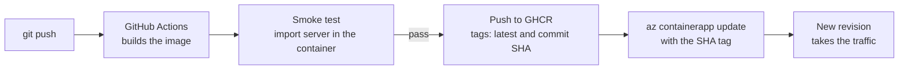

# AI Workspace

My personal site, with a live LLM agent running behind it: **[armansoylu.me](https://armansoylu.me)**

A FastAPI backend runs a Gemini function-calling agent that can search the web, check the weather, do arithmetic and remember things in a vector database. The same container serves the single-page UI (English, German, Turkish), exposes its search tools over MCP, and scales to zero on Azure Container Apps.



> The first request after an idle period takes about 30 seconds, because the container starts from zero.

## What it does

- **Chat with tool use.** Every answer shows which tools the model actually called, in order.
- **Multi-turn conversations.** History is kept per browser session on the server.
- **Long-term memory.** The agent can save facts to ChromaDB and search them later.
- **Model picker.** Flash-Lite and Flash are selectable. Pro is listed but locked, because Pro-class models are not available on the free Gemini tier.
- **MCP server.** Web search and memory search are also exposed to external MCP clients over SSE.
- **Data-driven UI.** The agents shown in the sidebar and dashboard come from a Python registry, so adding an agent means adding one entry there.

## Architecture

Everything runs in one process in one container.



### One chat turn



## API

| Method | Path | Purpose |
|---|---|---|
| `GET` | `/api/agents` | Agent registry, model table and default model. Feeds the whole UI. |
| `POST` | `/api/chat` | One turn with a live agent. Returns the reply and the tools that were called. |
| `POST` | `/api/chat/reset` | Drops the server-side history of one chat. |
| `GET` | `/api/health` | Liveness check. |
| `GET` | `/mcp/sse` | MCP endpoint (SSE transport) with `search_web` and `search_database`. |
| `GET` | `/cv` | My CV as a PDF, opened in the browser. |
| `POST` | `/chat` | Legacy single-shot endpoint, kept for the old Streamlit UI. |

## Tools the agent can call

| Tool | What it does |
|---|---|
| `get_weather_withAPI` | Geocodes the place with Open-Meteo, then fetches current temperature and wind. Reports the place that was actually matched. |
| `calculate` | Evaluates arithmetic with `simpleeval`, not `eval`. |
| `search_web` | Top three DuckDuckGo results. |
| `save_memory` | Stores a fact in the ChromaDB collection. |
| `search_vector_database` | Returns the three closest stored memories. |

## Project layout

```
server.py                  FastAPI app: API routes, MCP mount, static UI
agent/
  gemini_core.py           One agent turn: Gemini chat with a bounded tool loop
  registry.py              The agents the UI shows (single source of truth)
  sessions.py              Per-session chat history, in memory, LRU-evicted
tools/agent_tools.py       The Python functions the model can call
database/vector_db.py      ChromaDB client and collection
core/
  config.py                .env loading, model table, paths
  logger.py
frontend/                  Static UI, served as it is
  app.js                   State, views, API calls
  profile.js               Personal content of the home page
  i18n.js                  EN / DE / TR interface strings
  styles.css               Design tokens (OKLCH) and layout
.github/workflows/         Image build with a smoke test
Dockerfile, docker-compose.yml
AZURE_DEPLOY.md            Deployment notes (in Turkish)
main.py, ui.py             Earlier CLI and Streamlit front ends
SimpleAgent.ipynb          The notebook this project started from
```

## Run it locally

You need a Gemini API key from Google AI Studio.

With Docker:

```bash
git clone https://github.com/ArmanSoylu/AgenticProjects.git
cd AgenticProjects
git checkout master-gemini-arch-completed
echo "gemini_api_key=YOUR_KEY" > .env
docker compose up --build
```

Then open <http://localhost:8000>.

Without Docker (Python 3.10 or newer):

```bash
pip install -r requirements.txt
cp .env.example .env        # set gemini_api_key and AGENT_DB_PATH in it
python server.py
```

### Configuration

| Variable | Meaning |
|---|---|
| `gemini_api_key` | Required. Note the lowercase name. |
| `AGENT_DB_PATH` | Folder where ChromaDB keeps its data. Set it when running without Docker. |
| `MODEL_FLASH_LITE`, `MODEL_FLASH`, `MODEL_PRO` | Which Gemini model each entry of the model picker maps to. |
| `GEMINI_BILLING_ENABLED` | Set to `true` to unlock the Pro entry on a paid Gemini plan. |
| `PORT` | Port inside the container. Defaults to 7860. |

## Build and deployment



| Setting | Value |
|---|---|
| Platform | Azure Container Apps, France Central |
| Size | 1 vCPU, 2 GiB |
| Scale | 0 to 1 replicas (scale to zero) |
| Image | `ghcr.io/armansoylu/dreamer-api`, built by GitHub Actions |
| Secret | The Gemini key is a Container Apps secret, injected as `gemini_api_key` |
| Domain | `armansoylu.me` with a managed certificate |

The deployment is updated by image SHA, not by `latest`: Azure creates a new revision only when the image reference changes, so redeploying `latest` silently does nothing.

## Design decisions

**No frontend build step.** The UI is plain JavaScript served as static files. One container, one Dockerfile, no Node toolchain in the image.

**The registry is the single source of truth.** Agent names, status, tools and accent hue live in `agent/registry.py`. The live agent's tool list is derived from the Python functions themselves, so what the API reports cannot drift from what the agent can actually call.

**The tool loop is bounded.** The SDK chains tool calls on its own, with a default ceiling of ten. A user asked for the weather in a neighbourhood the geocoder did not know, and the model kept retrying with other place names. The loop is now capped at five calls per turn.

**Tool errors tell the model what to do next.** The same bug had a second cause: on a failed lookup the weather tool returned a message whose placeholder was never filled in, so the model could not tell what had gone wrong. The message now names the place that failed and says not to retry with another spelling, which ended the guessing.

**Pinned dependencies and a smoke test in CI.** With unpinned requirements, `pip` once resolved an old `mcp` release without `fastmcp`. The image built without errors and the container died on start. Versions are now pinned, and the workflow imports the app inside the built image before it pushes anything.

**In-process sessions, one replica.** Chat history lives in the server process. That keeps the design simple and is why the app is limited to a single replica.

**Scale to zero.** With no traffic the app costs nothing. The price is the cold start.

## Known limitations

- **Memory is not durable in production.** ChromaDB writes to the container's disk, which is lost when the app scales to zero.
- **Cold start of about 30 seconds** after an idle period.
- **Answers are not streamed.** The UI receives the complete reply at once.
- **No automated evaluation yet.** Correct tool choice is checked by hand.

## Roadmap

- An evaluation set for the agent (tool choice, answer correctness, latency) that runs in CI
- Durable memory on a mounted volume
- Streaming answers
